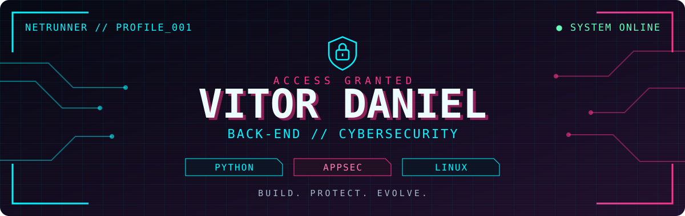
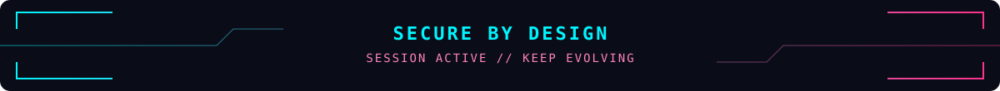

<div align="center">



# Vitor Daniel

**Engenharia de Software · Back-end · Cibersegurança**


<a href="https://github.com/VitorDanielRC"></a>


</div>

---

## 01 // 👤 Operator Profile

Sou estudante de **Engenharia de Software**, com interesse em desenvolvimento **Back-end**, **Cibersegurança** e segurança de aplicações web. Busco construir sistemas e APIs bem estruturados, com atenção à autenticação, à autorização e à validação de dados.

```text
$ whoami
  role      : Software Engineering Student
  focus     : Back-end / Application Security
  status    : Learning & building
  objective : Build secure systems
```

## 02 // ⚙️ Tech Arsenal

<div align="center">


</div>

| Área | Tecnologias |
| :--- | :--- |
| Back-end | Python, Django, Flask |
| APIs — em estudo | Django REST Framework, FastAPI |
| Banco de dados | PostgreSQL, MySQL, SQLite |
| Web | HTML, CSS, JavaScript |
| Ambiente e ferramentas | Linux, Bash, Docker, Git, GitHub, VS Code |

## 03 // 🛡️ Security Protocols

Meus principais temas de interesse e estudo em segurança:

- Segurança de aplicações web e APIs REST
- OWASP Top 10 e fundamentos de segurança da informação
- Autenticação, autorização e controle de acesso
- Validação de entradas e tratamento seguro de erros
- Gerenciamento de configurações e variáveis de ambiente

## 04 // 📂 Active Operations

### 🛗 Projeto IoT — Elevador Inteligente

Sistema em Django para gerenciamento de entregas realizadas por um elevador automatizado, com painel web, controle de usuários e endpoints para comunicação com o dispositivo IoT.

**Stack:** Python · Django · SQLite · HTML · CSS · JavaScript · API REST

[](https://github.com/VitorDanielRC/Projeto-iot)

### 🌳 Árvore Binária de Busca

Aplicação web para inserir, buscar, remover e organizar elementos em uma árvore binária de busca.

**Stack:** Python · Flask · HTML · CSS · JavaScript

[](https://github.com/VitorDanielRC/Arvore-Binaria-de-Busca)

## 05 // 🧠 Neural Upgrades

| Em estudo | Objetivo |
| :--- | :--- |
| OWASP Top 10 e testes de segurança | Entender e mitigar vulnerabilidades |
| JWT, Django REST Framework e FastAPI | Aprimorar autenticação e desenvolvimento de APIs |
| Linux, Bash, Docker e Docker Compose | Evoluir no ambiente de desenvolvimento |
| Pytest | Aprender testes automatizados |

## 06 // 🎓 Training Database

- **Engenharia de Software** — Universidade de Vassouras (em andamento)
- **Técnico em Mecânica Industrial** — SENAI
- **Técnico em Administração**

## 07 // 📊 System Analytics

<div align="center">


</div>

## 08 // 📡 Network Activity

<div align="center">


</div>

<details>
<summary>🐍 Neon contribution snake — animação da rede</summary>
<br>

<div align="center">

<picture>
  <source media="(prefers-color-scheme: dark)" srcset="https://raw.githubusercontent.com/VitorDanielRC/VitorDanielRC/output/github-contribution-grid-snake-dark.svg">
  
</picture>

</div>

[Status da geração automática](https://github.com/VitorDanielRC/VitorDanielRC/actions/workflows/snake.yml)

</details>

## 09 // 🔗 Secure Connection

<div align="center">

<a href="https://github.com/VitorDanielRC"></a>
<a href="https://www.linkedin.com/in/vitor-daniel-a2627326a/"></a>
<a href="mailto:vitorcabral2004@gmail.com"></a>

**Build systems. Break assumptions. Secure everything.**



</div>
